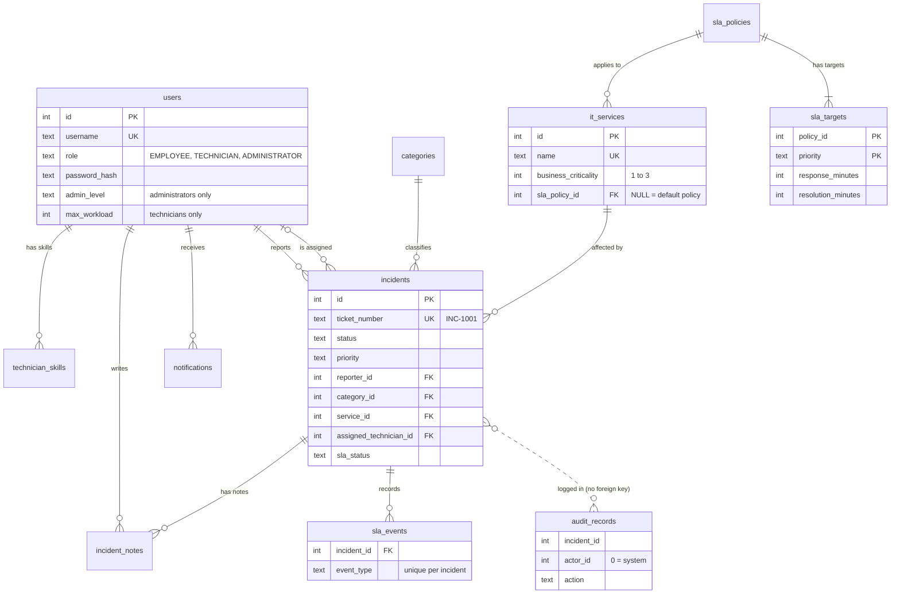

# Database design

The persistence layer (`app/persistence/`) stores every user, service, incident and audit record
in one **SQLite** file (default `data/iitsm.db`, git-ignored). It is written in plain SQL with
Python's built-in `sqlite3` module. The domain classes know nothing about it.

## 1. Entity-relationship diagram

The diagram below renders on GitHub. A PNG version for the report comes from
`docs/er_diagram.dbml`: paste it at <https://dbdiagram.io> (Import, then DBML) and export
`docs/er_diagram.png`.

## 2. Tables

12 tables, 10 indexes. `schema.sql` is the authoritative definition; every statement is
`IF NOT EXISTS`, so running it again is harmless.

| Table | Holds | Notes |
| --- | --- | --- |
| `users` | All three roles in one table | Role-specific columns (`department`, `admin_level`, `experience_years`, `available`, `max_workload`) are empty for the other roles. `username` is unique. |
| `technician_skills` | One row per technician skill | Primary key (`user_id`, `skill`). Deleted with the user. |
| `categories` | Incident categories | `required_skill` links a category to technician skills by name. |
| `it_services` | Services that can fail | `business_criticality` 1 to 3; `sla_policy_id` empty means "use the default policy". |
| `sla_policies`, `sla_targets` | SLA policies and their four priority targets | Primary key (`policy_id`, `priority`). Minutes must be positive. |
| `incidents` | The incident, including its SLA tracker, resolution and feedback | 36 columns. Nested objects (tracker, resolution, feedback) are flattened into prefixed columns. |
| `incident_notes` | Investigation notes and information requests and responses | Deleted with the incident. |
| `audit_records` | Append-only history of every action | No foreign key on `actor_id` (the system actor has id 0 and is not a user row). |
| `sla_events` | SLA warnings and violations that were recorded | `UNIQUE (incident_id, event_type)`: the database itself prevents an event being recorded twice. |
| `notifications` | In-app notifications | `channel` is IN_APP or EMAIL. |
| `settings` | Key and value pairs | Holds the active priority and assignment strategy names. |

**Indexes** speed up the common filters: on `incidents` for status, priority, service,
category, technician, reporter and created date; on `incident_notes` and `audit_records` for
incident; on `notifications` for recipient.

## 3. Key relationships, in words

- An incident is **reported by** one user, **classified by** one category, **about** one service
  and optionally **assigned to** one technician (a second link to `users`).
- A service may point at one SLA policy. A policy owns up to four targets (one per priority).
- An incident owns its notes, its SLA events, and (inside its own columns) its SLA tracker,
  resolution and feedback. Notes and SLA events are deleted if the incident is.
- Audit records mention the incident by id and ticket number but are not tied to it by a foreign
  key, so the history survives and the system actor (id 0) can appear in it.

## 4. Storage conventions

All conversion happens in `app/persistence/codec.py`.

| Python value | Stored as |
| --- | --- |
| `datetime` | ISO text, `2026-11-14 10:05:00` (sorts correctly as text) |
| `bool` | 0 or 1 |
| Enum | its member name, such as `IN_PROGRESS` (impact, urgency and criticality are stored as the numbers 1 to 3) |
| `None` | `NULL` |

## 5. How the layer works

- **Repository pattern.** One class per kind of object (`SqliteIncidentRepository` and so on)
  implements an interface from `app/ports/repositories.py`. Services only see the interfaces, so
  none of them contains SQL.
- **`Database` helper.** `with db.connection() as conn:` opens a short-lived connection for one
  operation, turns on foreign keys, **commits** when the block ends normally, **rolls back** when
  it fails, and always closes. A fresh connection per operation keeps the web server and the
  background scheduler (different threads) from ever sharing one.
- **WAL mode** lets the scheduler write while the web server reads.
- **Errors.** Any `sqlite3.Error` becomes our `PersistenceError`; raw database errors never leave
  this folder.
- **Saving.** `save` inserts when the object has no id and updates otherwise, then returns the
  object. A new object receives its id only after the transaction commits, so a failed save
  leaves nothing half-assigned. The first incident gets ticket `INC-1001`.
- **Loading lists.** A list of incidents is loaded with a fixed handful of queries (incidents,
  notes, users, technician skills, services, categories) and assembled in memory, never one query
  per incident.
- **Safety.** Every value reaches SQL as a `?` parameter. The only text inserted into SQL
  statements is fixed column names and lists of `?`.

## 6. Search and reports

`search(criteria)` filters on up to eleven optional criteria (ticket number, status, priority,
category, service, technician, reporter, SLA status, from date, to date, keyword), joined with
`AND`, newest first, capped at 500 rows. The keyword matches title or description, and `%` and
`_` typed by a user are treated as ordinary characters. The end date includes the whole day.

`ReportRepository` runs the dashboard queries with `COUNT`, `GROUP BY` and `LEFT JOIN`:
overview, technician workload (including technicians with no incidents), counts per service and
per category, and SLA violations.

## 7. Sample data

Produced by `python -m app.persistence.seeder` (see `docs/demo_data.md`). Row counts after
seeding:

| Table | Rows | | Table | Rows |
| --- | --- | --- | --- | --- |
| `users` | 20 | | `incident_notes` | 54 |
| `technician_skills` | 14 | | `audit_records` | 359 |
| `categories` | 9 | | `sla_events` | 10 |
| `it_services` | 8 | | `notifications` | 34 |
| `sla_policies` / `sla_targets` | 2 / 8 | | `incidents` | 45 |

Users (password hashes omitted):

| id | username | role | admin_level | experience_years | available | max_workload | department |
| --- | --- | --- | --- | --- | --- | --- | --- |
| 1 | admin1 | ADMINISTRATOR | TEAM_LEAD | | | | |
| 5 | tech1 | TECHNICIAN | | 8 | 1 | 5 | |
| 11 | emp1 | EMPLOYEE | | | | | Finance |

`tech1`'s rows in `technician_skills`: Application, Database, Storage.

Incidents (selected columns):

| id | ticket_number | title | priority | status | sla_status | assigned_technician_id |
| --- | --- | --- | --- | --- | --- | --- |
| 1 | INC-1001 | Email delivery delayed for finance tea... | P3 | CLOSED | MET | 5 |
| 24 | INC-1024 | Intranet portal returns 500 error | P3 | VERIFIED | MET | 7 |
| 33 | INC-1033 | New hire needs ERP access | P4 | ASSIGNED | ON_TRACK | 8 |
| 36 | INC-1036 | Payment transaction failing | P1 | ACKNOWLEDGED | VIOLATED | 7 |
| 45 | INC-1045 | Primary database cluster unreachable | P1 | ASSIGNED | ON_TRACK | 5 |

Audit trail of INC-1001, oldest first (`audit_records`):

| timestamp | actor_name | action | previous_status | new_status |
| --- | --- | --- | --- | --- |
| 2026-11-04 07:45:00 | Asha Verma | CREATED | | NEW |
| 2026-11-04 07:46:00 | System | CLASSIFIED | NEW | CLASSIFIED |
| 2026-11-04 07:47:00 | System | ASSIGNED | CLASSIFIED | ASSIGNED |
| 2026-11-04 08:09:00 | Ravi Kumar | ACKNOWLEDGED | ASSIGNED | ACKNOWLEDGED |
| 2026-11-04 08:10:00 | Ravi Kumar | INVESTIGATION_STARTED | ACKNOWLEDGED | IN_PROGRESS |
| 2026-11-04 08:11:00 | Ravi Kumar | NOTE_ADDED | IN_PROGRESS | IN_PROGRESS |
| 2026-11-04 11:45:00 | Ravi Kumar | RESOLVED | IN_PROGRESS | RESOLVED |
| 2026-11-04 11:55:00 | Asha Verma | VERIFIED | RESOLVED | VERIFIED |
| 2026-11-04 12:00:00 | Asha Verma | CLOSED | VERIFIED | CLOSED |

(Two further NOTE_ADDED rows and a FEEDBACK_SUBMITTED row are omitted for space. The dates
depend on the day the data was seeded.)

## 8. Why SQLite, and how we would move to PostgreSQL

**Why SQLite.** It needs no installation or server, the whole database is one file, and tests
create a throwaway file in milliseconds. That suits a team of four who must all run the same
project on their own laptops, and a demo that must start reliably. The expected data volume
(hundreds or thousands of incidents) is far below what SQLite handles comfortably.

**Moving to PostgreSQL later.** Because of the Repository pattern, only code inside
`app/persistence/` changes: the `Database` helper (a PostgreSQL driver instead of `sqlite3`),
the `Sqlite*Repository` classes (their SQL dialect, for example `INSERT ... RETURNING` for new
ids), and `schema.sql` (real date and boolean types instead of text and 0/1). The domain,
service and web layers do not change, and the architecture test confirms they never import
`sqlite3`.

**Scaling.** SQLite allows one writer at a time. With many concurrent users, PostgreSQL would
also give true multi-user concurrency, connection pooling and replication.

## 9. Known limitations

- **Note ids are not stable.** An incident's notes are replaced as a set on every save, so a
  note's id can change. Nothing in the system relies on it.
- **No migrations.** `schema.sql` creates missing tables but does not alter existing ones. After
  a schema change, delete `data/iitsm.db` and let it be recreated and re-seeded.
- **Seeding is not one transaction.** If it is interrupted, delete the database file and run it
  again.
- **A connection per operation** costs roughly 20 ms on the Windows development machine, which is
  why seeding 45 incidents takes about 11 seconds. This does not matter for normal use.
- **Deactivated users** are returned by `find_admins_by_level`; the service layer must filter them
  before sending notifications.

## 10. Differences from the original plan

- `incidents` has an extra column `resolution_at`, because the domain `Resolution` object carries
  its own time and storing it avoids losing information.
- `sla_events.event_type` accepts `RESPONSE_WARNING`, `RESOLUTION_WARNING`, `RESPONSE_VIOLATED`
  and `RESOLUTION_VIOLATED`, matching the domain enum (the plan listed a single `WARNING`).
- `Database` refuses `:memory:` and creates the data folder on first use.
